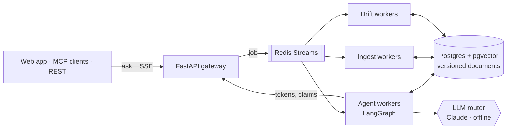

# Driftline

**A version-aware knowledge engine.** Driftline keeps every version of your documents and knows which version was in force on any date. It answers only from in-force sources, backs every claim with an exact-quote citation, and raises an alert when a source changes under an answer it already gave.


**[Live demo](https://pranavkrishnadanda.github.io/Driftline/demo/)** (the real UI replaying recorded Claude answers) · **[Report site and benchmarks](https://pranavkrishnadanda.github.io/Driftline/)** · [Full tour video](docs/media/driftline-demo.mp4)

## Why

Plain RAG answers from whatever it retrieves, including superseded text: a drug-label warning rewritten two versions ago, or a Kubernetes field removed three releases back. The citation looks fine, but the source is no longer in force. Driftline makes time part of the question ("what was true **as of** this date or release"). It verifies every quote against the exact version it cites, and re-checks saved answers whenever a new version lands.

It ships with two real corpora, **openFDA / DailyMed drug labels** and **Kubernetes docs (release branches)**, and also accepts your own Markdown, PDF or DOCX files.

## Results

Driftline against plain RAG (the same retriever and reranker with the as-of filter off, one draft, no verifier), answered by real Claude (`claude-sonnet-5-5`). The sample is 40 of 150 golden cases per corpus, run at commit `e0c7cc1` for **$3.061530** in total. A test fails if this table drifts from the [report JSON](evals/reports/e0c7cc1faecf51cee1428bd8d7ad76055f3b39b7/claude).

<!-- results-table:start -->
| Corpus | System | Cases | Citation precision | Outdated-citation rate | Trap precision | Trap outdated rate | Faithfulness (verifier) | Insufficient-evidence acc. | p95 latency (ms) | Cost / answer (USD) |
|---|---|---|---|---|---|---|---|---|---|---|
| pharma | `driftline` | 40 | 1.0000 | 0.0000 | 1.0000 | 0.0000 | 1.0000 | 0.9500 | 40597 | 0.0219 |
| pharma | `plain_rag` | 40 | 0.7917 | 0.2083 | 0.8889 | 0.1111 | 0.8000 | 0.7750 | 14286 | 0.0133 |
| k8s | `driftline` | 40 | 1.0000 | 0.0000 | 1.0000 | 0.0000 | 1.0000 | 1.0000 | 45052 | 0.0292 |
| k8s | `plain_rag` | 40 | 0.9688 | 0.0156 | 0.9500 | 0.0500 | 0.9667 | 0.9750 | 15135 | 0.0122 |
<!-- results-table:end -->

**The trade-off:** about 3× the p95 latency and 1.6–2.4× the cost of plain RAG, and 2 of 40 answerable pharma questions declined as insufficient evidence. Details are in [`evals/RESULTS.md`](evals/RESULTS.md).

**Load and chaos** (k6, stub LLM, 4-vCPU VM): 4 workers give p50/p95/p99 of 35.7/39.4/40.9 s with 0 errors. Under chaos, 86 of 86 asks succeeded across 8 worker kills, with 0 lost jobs. The reranker is the bottleneck. See the [benchmarks page](https://pranavkrishnadanda.github.io/Driftline/benchmarks.html).

## How it works



- **Temporal version store.** Each version has a `[valid_from, valid_to)` window. A Postgres exclusion constraint guarantees the windows never overlap.
- **As-of hybrid retrieval.** Vector search and full-text search (fused with reciprocal-rank fusion) run with the in-force filter applied inside the query, followed by a cross-encoder rerank.
- **LangGraph agent.** It plans, fans out parallel retrieval subagents, and drafts with streamed tokens. It then verifies each claim's quote against the cited version and re-retrieves when a claim fails. It refuses with "insufficient evidence" rather than guessing.
- **Drift detection and human review.** When a new version arrives, watched answers are re-checked claim by claim (still valid, changed or broken). Low-confidence answers pause for a reviewer through `interrupt()`.
- **Crash-safe at scale.** Redis consumer groups with `XAUTOCLAIM` and a dead-letter queue, a transactional outbox, and a Postgres checkpointer, so a crashed ask resumes on another worker.
- **Resilient LLM layer.** Fallback chains, a circuit breaker, a shared Redis token bucket and per-call cost tracking. Offline mode runs with no API key.

All six detailed diagrams (system, ask lifecycle, agent graph, ingestion and drift, data model, CI/CD) are in [`docs/architecture.md`](docs/architecture.md).

## Quick start

```bash
cp deploy/compose/.env.example deploy/compose/.env
# add DRIFTLINE_ANTHROPIC_API_KEY=<key>, or DRIFTLINE_LLM_OFFLINE=true for no key
docker compose -f deploy/compose/docker-compose.yml up -d --build

curl -s localhost:8010/v1/ask -H 'content-type: application/json' \
  -d '{"tenant": "demo", "question": "What does a Deployment rollout do?", "as_of": "2026-01-15T00:00:00Z"}'
curl -N localhost:8010/v1/jobs/<job_id>/events     # live SSE: step, token, claim ... final

cd frontend && bun install && bun run dev          # web app at http://localhost:3000
```

Ingesting sources, ports and the web app pages are covered in [`docs/getting-started.md`](docs/getting-started.md). The full API is at `http://localhost:8010/docs` and in [`contracts/openapi.json`](contracts/openapi.json).

## Use from Claude Code / Cursor

The gateway serves an MCP server at `/mcp` with five tools: `ask`, `list_sources`, `get_timeline`, `diff_versions` and `watch_answer`.

```bash
claude mcp add --transport http driftline http://localhost:8010/mcp --header "Authorization: Bearer $DRIFTLINE_KEY"
```

See the [MCP guide](docs/mcp.md) for API keys and the Cursor setup. The [Claude Code Skill](.claude/skills/driftline/SKILL.md) teaches the agent when to use the tools.

## Testing

Test-first, with **no mocks**: real Postgres, Redis and TEI through testcontainers, recorded vcrpy cassettes for external APIs, and real in-repo stand-ins (`DeterministicAdapter`, `ManualClock`). **740 backend and 309 frontend tests pass.** Pull requests are gated by an offline eval ([`eval.yml`](.github/workflows/eval.yml)).

```bash
cd backend && uv sync && uv run pytest -q
cd frontend && bun run test
```

## Tech stack

**Backend:** Python 3.12, FastAPI, LangGraph, Postgres 16 + pgvector, Redis Streams, Anthropic Claude, Hugging Face TEI, MCP SDK, OpenTelemetry. **Frontend:** Next.js 16, React 19, Tailwind 4, Motion, anime.js, Kokonut UI, Bklit UI, React Flow, built with Bun, Oxlint, Biome and `tsgo`. **Infra:** Docker Compose, GitHub Actions, GitHub Pages.

More screenshots are in [`docs/screenshots`](docs/screenshots/README.md). The design spec and phase plans are in [`docs/superpowers`](docs/superpowers).

*Driftline is an engineering project. Its answers are not legal, medical or compliance advice.*
