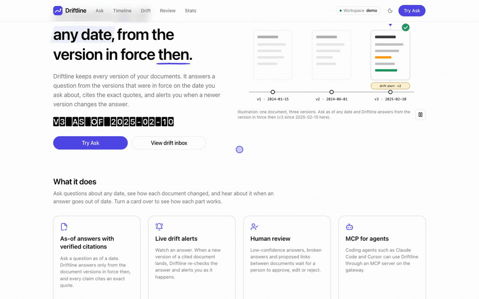
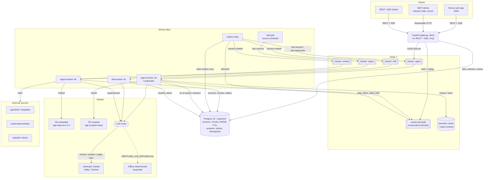
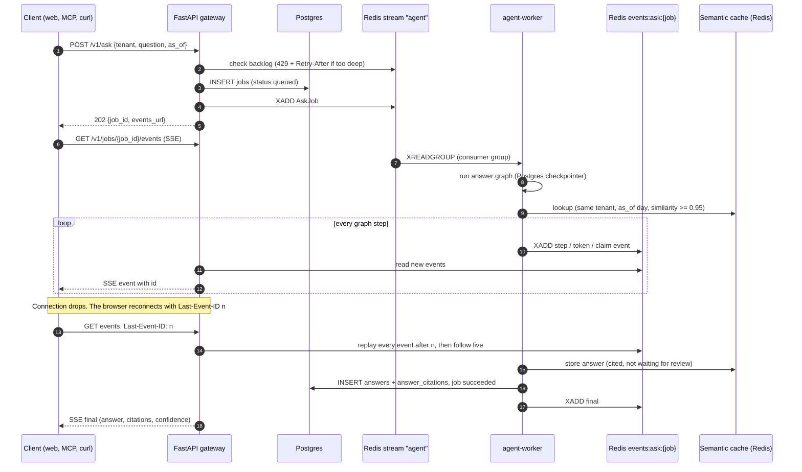
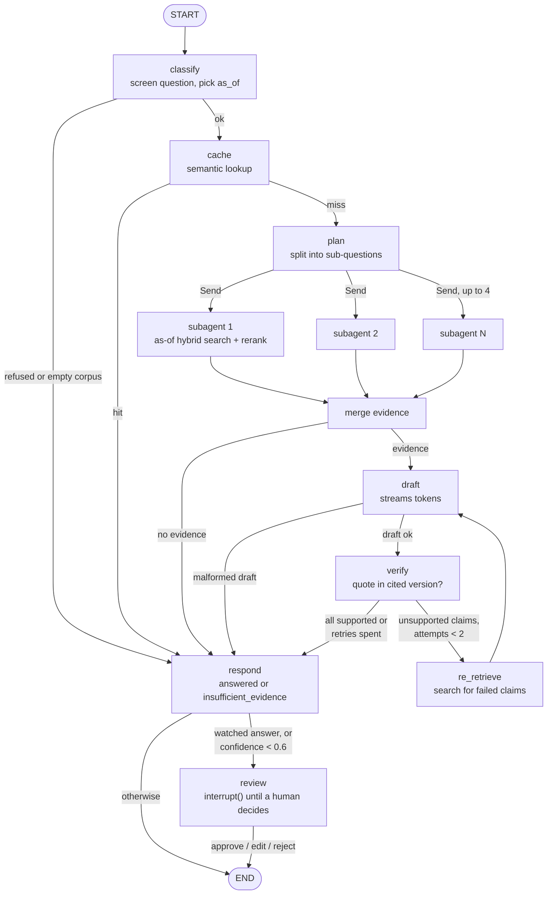
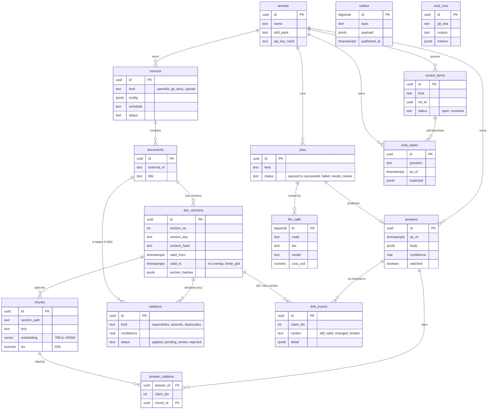
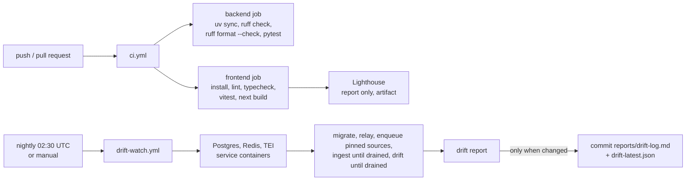

# Driftline

**A version-aware knowledge engine.** Driftline keeps every version of your documents and knows which version was in force on any date. It answers questions only from in-force sources, backs every claim with an exact-quote citation, and raises an alert when a source changes under an answer it already gave.



**[Try the live recorded demo](https://pranavkrishnadanda.github.io/Driftline/demo/)**: the real UI replaying real answers from a recorded run. Full tour: [MP4](docs/media/driftline-demo.mp4) · [GIF](docs/media/driftline-demo.gif).

## Why it matters

Regular RAG answers from whatever text it retrieves, and that includes superseded text. Ask it about a drug label or a Kubernetes API and it can quote a warning that was rewritten two versions ago, or a field that was removed three releases back. The citation looks fine, but the source is no longer in force.

Driftline treats time as part of the question. It answers "what was true **as of** this date (or this release)", checks every quote against the exact version it cites, and keeps watching: when a new version changes or removes a section that a saved answer relies on, the answer is flagged and can go back to a human.

It works across domains. v1 ships with two real corpora, plus your own documents:

| Corpus | Source | How versions are tracked |
|---|---|---|
| Pharma / healthtech | openFDA (discovery) + DailyMed SPL history | Every published label version: `effective_time` becomes `valid_from` |
| Software | `kubernetes/website` release branches | One version per `release-1.N` branch, from the v1.N.0 release date |
| Bring your own | Markdown / PDF / DOCX folder | Re-uploading the same path creates a new version |

## Results

Driftline against plain RAG (the same retriever and reranker with the as-of filter off, one draft, no verifier), answered by real Claude. The numbers are copied from the report JSON in [`evals/reports/e0c7cc1…/claude/`](evals/reports/e0c7cc1faecf51cee1428bd8d7ad76055f3b39b7/claude); a test (`backend/tests/eval/test_site.py`) fails if this table drifts from them.

- **Sample:** 40 of 150 golden cases per corpus (pharma and k8s), a deterministic stratified sample (13 traps each), not the full sets.
- **Model:** answer and judge tiers `claude-sonnet-5-5`, planner `claude-haiku-5-5`.
- **Date and cost:** run on 2026-10-25 at commit `e0c7cc1`; the reported runs cost **$3.061530** in total.

<!-- results-table:start -->
| Corpus | System | Cases | Citation precision | Outdated-citation rate | Trap precision | Trap outdated rate | Faithfulness (verifier) | Insufficient-evidence acc. | p95 latency (ms) | Cost / answer (USD) |
|---|---|---|---|---|---|---|---|---|---|---|
| pharma | `driftline` | 40 | 1.0000 | 0.0000 | 1.0000 | 0.0000 | 1.0000 | 0.9500 | 40597 | 0.0219 |
| pharma | `plain_rag` | 40 | 0.7917 | 0.2083 | 0.8889 | 0.1111 | 0.8000 | 0.7750 | 14286 | 0.0133 |
| k8s | `driftline` | 40 | 1.0000 | 0.0000 | 1.0000 | 0.0000 | 1.0000 | 1.0000 | 45052 | 0.0292 |
| k8s | `plain_rag` | 40 | 0.9688 | 0.0156 | 0.9500 | 0.0500 | 0.9667 | 0.9750 | 15135 | 0.0122 |
<!-- results-table:end -->

**Where Driftline loses.** It is slower and costs more: p95 latency is about 3× plain RAG's (40597 vs 14286 ms on pharma, 45052 vs 15135 ms on k8s), and cost per answer is 1.6× (pharma) and 2.4× (k8s). On pharma it declined 2 of 40 answerable cases as insufficient evidence (`pharma-028`, `pharma-099`). The `no_retrieval` baseline and the faithfulness LLM judge were not run; faithfulness here is the verifier's deterministic check.

The full write-up, with the offline CI-gate baselines, metric definitions, machine and cost breakdown, is in [`evals/RESULTS.md`](evals/RESULTS.md). The report site, [https://pranavkrishnadanda.github.io/Driftline/](https://pranavkrishnadanda.github.io/Driftline/) (live after first deploy), renders the same reports plus benchmarks and the nightly drift log; it is built by `python -m driftline.eval site` and deployed by [`pages.yml`](.github/workflows/pages.yml).

## Features

What is built and tested today:

- **Temporal version store.** Each document version has a `[valid_from, valid_to)` window. A Postgres `btree_gist` exclusion constraint guarantees that the windows of one document never overlap. A new version closes the previous window in the same transaction. Re-ingesting the current content is a no-op.
- **As-of hybrid retrieval.** pgvector cosine search and Postgres full-text search are fused with reciprocal-rank fusion (top 30), then reranked by an open-source cross-encoder (top 8). The in-force filter is part of both searches, not a post-filter. Documents replaced by an applied `supersedes` / `deprecates` relation drop out.
- **LangGraph answer agent.** The agent classifies the question and picks its as-of date (from the request, a date in the question, or a release such as "v1.24"). It plans sub-questions, fans out up to 4 retrieval subagents in parallel, drafts with streamed tokens, then verifies each claim's quote against the cited version. Unsupported claims trigger up to 2 re-retrieval loops. If nothing can be verified, it answers "insufficient evidence" and lists the nearest sources instead of guessing.
- **Live streaming with replay.** Every step, token and verified claim is appended to a per-job Redis stream. The SSE endpoint replays from `Last-Event-ID`, so a reconnecting browser misses nothing.
- **Drift detection.** When a document gets a new version, the drift engine re-checks every watched answer that cites it. Each claim gets a verdict: `still_valid` (the citation moves silently to the new version), `changed` (with a before/after diff) or `broken` (the section was removed). Alerts stream per tenant over SSE.
- **Human review queue.** Low-confidence answers pause the graph with a LangGraph `interrupt()` until a reviewer approves, edits or rejects them. Broken answers and uncertain supersession links are queued too. Every follow-up goes through the transactional outbox, and every edit becomes an eval case.
- **Supersession extraction.** Claude extracts "supersedes / amends / deprecates" links between documents. A link is applied automatically only when confidence is ≥ 0.8 **and** the quoted evidence really appears in the new version. Anything weaker goes to human review.
- **Semantic answer cache.** Redis-backed, keyed by tenant, as-of day and corpus filter, with cosine similarity ≥ 0.95. A hit is served only if every version it cites is still in force. Entries are dropped when a cited version is superseded.
- **Distributed, crash-safe workers.** Redis Streams consumer groups, `XAUTOCLAIM` to reclaim work from crashed workers after 60 s, a dead-letter queue after 3 failed deliveries, a transactional outbox relayed with `SKIP LOCKED`, and a Postgres LangGraph checkpointer, so a crashed ask resumes in another worker from its last finished node. Workers scale with `--scale <worker>=N`. The gateway returns 429 with `Retry-After` when the ask backlog is over its limit.
- **Resilient LLM router.** Fallback chains per tier, a circuit breaker (opens after 5 straight failures or a ≥ 50 % error rate, then allows one half-open probe), retries with jitter, a Redis Lua token bucket shared by every worker, a `degraded` flag when a fallback model answered, and per-call cost accounting in `llm_calls`.
- **Offline mode.** Set `DRIFTLINE_LLM_OFFLINE=true` and the agent and drift workers use an in-repo deterministic extractive responder instead of Claude. Demos and the nightly drift watch run with no paid key.
- **MCP server and Claude Code Skill.** Five tools at `/mcp` (Streamable HTTP) for Claude Code, Cursor and other MCP clients, plus a Skill that teaches the agent when to use them.
- **Domain skill packs.** Versioned packs in [`skills/`](skills) (`pharma@1.0.0`, `k8s@1.0.0`, `generic@1.0.0`) tune retrieval, chunking, prompts and glossary per tenant.
- **Web app.** A Next.js app with a live agent timeline, a version timeline with a supersession graph, a drift inbox, a review queue and a stats dashboard.
- **Observability.** OpenTelemetry spans per graph node, exported to Langfuse only when its keys are set (otherwise a no-op). `GET /v1/stats` reports corpus size, drift, ask latency and throughput, cost and cache hit rate.

## Architecture

Driftline is a modular monolith: one Python package, run as one HTTP gateway and a fleet of horizontally scalable workers. The processes never call each other directly. They share Postgres (the source of truth) and Redis (streams, caches and rate limits). Every service below is a real entry in [`deploy/compose/docker-compose.yml`](deploy/compose/docker-compose.yml), except the web app, which runs on its own (`bun run dev`).

### 1. System overview



How to read it:

- **The gateway is thin.** It authenticates the tenant, writes a `jobs` row, pushes work onto a stream and serves events. It never calls a model.
- **Streams carry work, Postgres carries truth.** Anything that must not be lost (a new version, a drift alert, a reviewer's decision) is first written to the `outbox` table in the same transaction as the change. The `outbox-relay` then publishes it to Redis. If the relay crashes, the row is simply published later.
- **Every worker type scales out.** Consumer groups split the work, `XAUTOCLAIM` takes over messages from a dead consumer after 60 s, and the 3rd failed delivery goes to `dlq:<stream>`. `drift-poll` needs only one replica: it claims each due source with a compare-and-set.
- **The LLM router** has four tiers. `extract` is Haiku (planning, supersession). `answer` is Sonnet, then Haiku (drafting). `judge` is Sonnet, then Haiku (claim checks). `embed` goes to TEI. Optional fallbacks come after these: extra Claude models, then Gemini when `DRIFTLINE_GEMINI_API_KEY` is set. With `DRIFTLINE_LLM_OFFLINE=true`, the agent and drift workers swap every LLM tier for the in-repo deterministic responder. Without an LLM key, the ingest worker still chunks and embeds, but skips supersession extraction.

### 2. The ask lifecycle

What happens between `POST /v1/ask` and the final answer, including a dropped connection:



Notes:

- A cache hit skips the planner, retrieval and models entirely (step 9). Only cited answers that are not waiting for review are stored, and a hit is served only if every version it cites is still in force at the requested `as_of`.
- The event log is capped (10,000 events) and expires after 24 h. A client that asks for an expired range gets an `error` event with code `events_expired` instead of silent gaps. Heartbeats keep idle connections alive every 15 s.
- `GET /v1/jobs/{job_id}` returns the same final answer for clients that poll instead of streaming. The MCP `ask` tool uses the same job path and waits for the result.
- If a worker crashes mid-ask, another worker reclaims the stream entry and resumes from the last checkpointed node. A queued ask whose stream entry was lost is failed by the `reap` sweep (`enqueue_lost`), never left hanging.

### 3. The LangGraph answer graph

The real nodes and conditional edges of [`agents/graph.py`](backend/src/driftline/agents/graph.py):



- **Insufficient evidence path.** If no claim survives verification (or there was no evidence or no valid draft), `respond` returns `status: insufficient_evidence` with the nearest in-force sources and `confidence: 0`. It never returns an unverified answer.
- **Confidence** is the share of claims that verified, scaled by 0.9 when a fallback model answered (`degraded`).
- **Review.** When the graph pauses at `review`, the worker opens a `low_confidence_answer` review item and marks the job `needs_review`. The reviewer's decision is written to the outbox as `ask.resume`, the relay puts it on the `agent` stream, and a worker resumes the same thread from its checkpoint.

### 4. Ingestion, outbox and drift detection

```mermaid
flowchart LR
  subgraph ingest["ingest-worker: stream ingest"]
    ENQ["drift-poll or CLI enqueue"] -->|"XADD ingest"| FETCH["connector fetch<br/>openFDA/DailyMed, k8s git, upload"]
    FETCH --> HASH["hash content<br/>+ per-section hashes"]
    HASH --> CHUNK["section-aware chunks<br/>256 tokens"]
  end

  subgraph tx["one Postgres transaction"]
    CLOSE["close previous version<br/>set valid_to"] --> INS["insert doc_version + chunks"]
    INS --> OBX["outbox row<br/>version.created"]
  end

  CHUNK --> CLOSE
  CHUNK -.->|"same as current version"| NOOP["no-op"]
  OBX --> RELAY["outbox-relay<br/>SKIP LOCKED"]
  RELAY -->|"XADD embed"| EMBED["ingest-worker: embed via TEI<br/>+ supersession extraction"]
  RELAY -->|"XADD drift"| ENGINE["drift-worker: drift engine"]
  EMBED -.->|"confidence < 0.8 or<br/>quote not found"| RQ

  ENGINE --> DIFF{"cited section:<br/>cited vs latest version"}
  DIFF -->|"unchanged, or changed<br/>but quote still verifies"| SV["still_valid<br/>re-point citation"]
  DIFF -->|"changed, quote fails"| CH["changed<br/>+ before/after diff"]
  DIFF -->|"section removed"| BR["broken"]

  CH --> ALERT["outbox row<br/>drift.alert"]
  BR --> ALERT
  BR --> RQ["review queue<br/>review_items"]
  ALERT -->|"relay"| ALOG[["events:alerts:{tenant}"]]
  ALOG --> SSE["GET /v1/alerts/stream<br/>SSE drift inbox"]
  RQ --> RES["POST /v1/review/{id}/resolve"]
  RES -->|"outbox ask.regenerate<br/>or ask.resume"| AGENT[["stream: agent"]]
  RES -->|"outbox cache.invalidate"| CINV["drop cached answers<br/>citing replaced versions"]
```



- **Exactly one version per change.** `upsert_version` compares the new content with the current version. If they match, nothing happens. Otherwise it closes the old window, inserts the new version and its chunks, and writes the `version.created` outbox row, all in one transaction. Reverting to older content creates a new version, too.
- **Fan-out.** `TOPIC_STREAMS` in [`ingest/outbox.py`](backend/src/driftline/ingest/outbox.py) maps `version.created` to the `embed` and `drift` streams, and `ask.resume` / `ask.regenerate` to `agent`. `drift.alert` goes to the tenant's alert log, and the relay applies `cache.invalidate` directly.
- **The drift engine** compares each cited section between the cited version and the document's **latest** version, so a worker that falls behind (v1, v2, v3) evaluates once, against v3. All writes for one event happen in one transaction under a per-document advisory lock. A unique index on `(answer_id, new_version_id, claim_idx)` makes redelivery harmless. `still_valid` re-points silently; `changed` and `broken` raise alerts. `broken` also opens a `broken_answer` review item. Approving it regenerates the answer through the agent.
- **Review effects commit with the decision.** Resolving an item locks it (`FOR UPDATE`), so a second resolve gets 409. Its follow-ups (resume, regenerate, cache invalidation) are outbox rows in the same transaction.

### 5. Data model

The core tables, from the Alembic migrations in [`backend/migrations/versions`](backend/migrations/versions):



`outbox` and `eval_runs` stand alone: the outbox is a queue of topics with JSON payloads, and an eval run records metrics per commit and corpus. Two smaller tables are not drawn: `source_cursors` (per-source fetch cursors) and the LangGraph checkpointer's own tables.

### 6. CI/CD and automation



The backend CI job runs the full suite against real service containers (testcontainers). The drift watch runs offline (`DRIFTLINE_LLM_OFFLINE=true`), so it needs no paid key. `eval.yml` gates pull requests on the offline eval, and `pages.yml` rebuilds and deploys the report site when reports change.

## Tech stack

**Backend:** Python 3.12, FastAPI, asyncpg, Pydantic, Redis 7 Streams, Postgres 16 + pgvector + `btree_gist`, Alembic, LangGraph (Postgres checkpointer), LlamaIndex (sentence splitting), the MCP Python SDK, Anthropic Claude (Haiku / Sonnet), Hugging Face TEI (`BAAI/bge-base-en-v1.5` embeddings, `BAAI/bge-reranker-base` reranking), optional Gemini fallback, OpenTelemetry with Langfuse, uv, ruff.

**Frontend:** Next.js 16 (App Router), React 19, TypeScript, Tailwind CSS 4, shadcn/ui on Base UI, TanStack Query, Motion, anime.js, Kokonut UI and Bklit UI (installed as source from their shadcn registries), React Flow (`@xyflow/react`, the supersession graph), visx, Testing Library, Playwright with axe.

**Frontend toolchain:** Bun (package manager and script runner), Turbopack + SWC (Rust), Tailwind v4 Oxide / Lightning CSS (Rust), Oxlint + Biome (Rust), `tsgo` (TypeScript 7, Go), Vitest on Vite 8 / Rolldown (Rust), Playwright.

**Infra:** Docker Compose, GitHub Actions, testcontainers, vcrpy cassettes.

## Quick start

Prerequisites: Docker (Colima or Docker Desktop), [uv](https://docs.astral.sh/uv/) for running the backend outside Docker, [Bun](https://bun.sh) for the web app, and either an Anthropic API key or offline mode.

```bash
# 1. Configure ports and secrets (deploy/compose/.env is git-ignored)
cp deploy/compose/.env.example deploy/compose/.env
# Then add ONE of these lines to deploy/compose/.env:
#   DRIFTLINE_ANTHROPIC_API_KEY=<your key>     # answers with Claude
#   DRIFTLINE_LLM_OFFLINE=true                 # no key: deterministic offline answers

# 2. Start the stack: Postgres, Redis, TEI embedder + reranker, gateway and all workers
docker compose -f deploy/compose/docker-compose.yml up -d --build --scale ingest-worker=3

# 3. Check health (the gateway applies migrations before /healthz answers)
curl localhost:8010/healthz
curl localhost:8010/readyz
```

| Service | Host port | Env var to change it |
|---|---|---|
| Gateway (REST, SSE, `/mcp`, `/docs`) | `8010` | `DRIFTLINE_GATEWAY_PORT` |
| Postgres | `5433` | `DRIFTLINE_POSTGRES_PORT` |
| TEI embedder | `8080` | `DRIFTLINE_EMBED_PORT` |
| TEI reranker | `8081` | `DRIFTLINE_RERANK_PORT` |
| Redis | `6379` | fixed |

On amd64 hosts, set `DRIFTLINE_EMBED_IMAGE=ghcr.io/huggingface/text-embeddings-inference:cpu-1.9.4` (the default TEI tag is the native arm64 one).

**Ingest documents.** `enqueue` creates the tenant if needed and queues one ingest job per document. `--discover` lists everything the source offers.

```bash
# Kubernetes docs: two files across two release branches
docker compose -f deploy/compose/docker-compose.yml exec ingest-worker \
  python -m driftline.ingest enqueue --tenant demo --kind git_docs --discover \
  --config '{"branches": ["release-1.35", "release-1.36"], "paths": ["content/en/docs/concepts/workloads/controllers/deployment.md"]}'

# Drug labels: openFDA discovery + DailyMed version history (here: the Lipitor label)
docker compose -f deploy/compose/docker-compose.yml exec ingest-worker \
  python -m driftline.ingest enqueue --tenant demo --kind openfda --discover \
  --config '{"search": "set_id:\"a60cc18b-0631-4cf0-b021-9f52224ece65\"", "limit": 1}'

# Your own files: copy them into the uploads volume first
docker compose -f deploy/compose/docker-compose.yml cp --index 1 ./my-docs/. ingest-worker:/data/uploads/
docker compose -f deploy/compose/docker-compose.yml exec ingest-worker \
  python -m driftline.ingest enqueue --tenant demo --kind upload --discover \
  --config '{"root": "/data/uploads"}'
```

The pinned sources that the nightly drift watch uses are in [`deploy/drift-watch/sources.json`](deploy/drift-watch/sources.json), if you want a known-good set.

**Ask a question.** In dev mode (`DRIFTLINE_AUTH_REQUIRED` unset) the tenant name is enough. With an API key, send it as `Authorization: Bearer <key>`.

```bash
curl -s localhost:8010/v1/ask -H 'content-type: application/json' \
  -d '{"tenant": "demo", "question": "What does a Deployment rollout do?", "as_of": "2026-01-15T00:00:00Z"}'
# -> {"job_id": "...", "events_url": "/v1/jobs/<job_id>/events", "status_url": "/v1/jobs/<job_id>"}

curl -N localhost:8010/v1/jobs/<job_id>/events    # live SSE: step, token, claim ... final
```

The full API (ask, jobs, watch, drift events, alerts stream, document timeline, review, stats) is browsable at `http://localhost:8010/docs`. A checked-in copy is in [`contracts/openapi.json`](contracts/openapi.json).

**Run the web app.**

```bash
cd frontend
bun install
bun run dev        # http://localhost:3000, talks to NEXT_PUBLIC_DRIFTLINE_API (default http://localhost:8010)
```

Pages: `/` (landing), `/ask` (live agent timeline and cited answer), `/timeline` and `/documents/[id]` (version history with diffs and the supersession graph), `/drift` (drift inbox), `/review` (review queue) and `/stats`. See [`frontend/README.md`](frontend/README.md) for details.

## Use from Claude Code / Cursor (MCP)

The gateway serves an MCP server at `/mcp` (Streamable HTTP) with five tools:

| Tool | What it does |
|---|---|
| `ask` | A cited answer as of a date or release |
| `list_sources` | The tenant's sources and corpora |
| `get_timeline` | Every version of a document, with validity windows and relations |
| `diff_versions` | What changed between two versions |
| `watch_answer` | Get drift alerts when an answer's sources change |

`/mcp` always needs a tenant API key as a bearer token. Create one (see [API keys](docs/mcp.md#api-keys)), then register the server:

```bash
export DRIFTLINE_KEY=<your tenant key>
claude mcp add --transport http driftline http://localhost:8010/mcp --header "Authorization: Bearer $DRIFTLINE_KEY"
```

The repo's Claude Code Skill, [`.claude/skills/driftline/SKILL.md`](.claude/skills/driftline/SKILL.md), teaches the agent when to use Driftline, to always pass `as_of` for historical questions, and how to read citations. The [MCP guide](docs/mcp.md) covers creating API keys, the Cursor config, `DRIFTLINE_MCP_ALLOWED_HOSTS` for Compose and remote hosts, a reference for every tool, and troubleshooting (401, 421).

## Testing philosophy

Driftline is built test-first (red, green, refactor), and the tests follow one hard rule: **no mocks**. Test files never use `unittest.mock`, `patch`, `MagicMock`, `monkeypatch` of project code, or `vi.mock`. Instead:

- **Real infrastructure.** Postgres + pgvector, Redis and TEI run as real containers started by testcontainers. The tests exercise the real SQL, the exclusion constraint, the stream consumer groups and the Lua rate limiter.
- **Recorded LLM traffic.** Anthropic, openFDA, DailyMed and GitHub responses are replayed from vcrpy cassettes, scrubbed of keys and account IDs. A test whose cassette is not recorded yet is skipped with a clear reason, never faked.
- **Real stand-ins, shipped in the code.** Logic that depends on an LLM uses `DeterministicAdapter`, a real provider implementation in `driftline.llm.adapters`, and time-dependent logic uses an injected `ManualClock`.
- **Frontend.** Vitest + Testing Library for components, reducers and the SSE client, and Playwright (with axe accessibility checks) end to end against the Compose stack.

Current counts, as of commit `90c0f18` (run locally on 2026-10-25):

| Suite | Command | Result |
|---|---|---|
| Backend | `cd backend && uv run pytest -q` | **697 passed, 2 skipped** (2 Gemini adapter tests whose cassettes are not recorded) |
| Frontend | `cd frontend && bun run test` | **271 passed** in 26 files (Vitest) |

```bash
cd backend
uv sync
uv run pytest -q
uv run ruff check . && uv run ruff format --check .
```

With Colima, point testcontainers at the socket:

```bash
DOCKER_HOST=unix://$HOME/.colima/default/docker.sock \
TESTCONTAINERS_DOCKER_SOCKET_OVERRIDE=/var/run/docker.sock uv run pytest -q
```

## Evaluation

The evaluation harness (`python -m driftline.eval`) compares three systems on the same questions: full **Driftline**, **plain RAG** (the same retriever and reranker with the as-of filter turned off, and a single draft), and **no retrieval** (the model alone). It scores citations against the database and checks claims with the same verifier the agent uses.

The golden sets are in [`evals/golden`](evals/golden/README.md): **300 validated questions** (150 pharma, 150 Kubernetes), including "trap" questions whose answer changed between versions. Every case was drafted from the real ingested corpora and passed automatic validation against the database. None was written or edited by hand.

Pull requests are gated by [`eval.yml`](.github/workflows/eval.yml): an offline, deterministic run on a 40 + 40 subset that fails if citation precision drops by more than 2 points or the outdated-citation rate rises by more than 1 point. The numbers are in [Results](#results).

## Nightly drift watch

Every night, [`drift-watch.yml`](.github/workflows/drift-watch.yml) ingests a small pinned set of real sources (5 DailyMed drug labels and 2 Kubernetes docs pages across two release branches) into a fresh database. It runs drift detection offline and commits [`reports/drift-log.md`](reports/drift-log.md) and [`reports/drift-latest.json`](reports/drift-latest.json) whenever they change. The log lists every document version change, newest first.

## Screenshots

The web app, shown with its seeded demo workspace (not eval data).

| | |
|---|---|
|  |  |
| Landing | Ask: a cited answer, each claim verified against the source version |
|  |  |
| Document timeline: versions, what changed, related documents | Drift inbox: answers whose cited text changed or was removed |
|  |  |
| Review queue | Stats |
|  |  |
| Dark theme | Phone |

## Roadmap

| Phase | Scope | Status |
|---|---|---|
| P1 Foundation | Schema, Streams, rate limiter, breaker, router, gateway, CI | ✅ Done |
| P1b Providers | Anthropic, TEI embeddings, Gemini fallback | ✅ Done |
| P2 Ingestion | openFDA/DailyMed, Kubernetes docs, upload, version store, outbox, supersession | ✅ Done |
| P3 Retrieval + Agent | Hybrid as-of search + rerank, LangGraph agent with subagent fan-out, citation verifier, `/v1/ask` + SSE replay, semantic cache | ✅ Done |
| P4 Drift + Review | Drift re-verification, alerts, human review queue with `interrupt()`, nightly drift watch | ✅ Done |
| P5 Frontend | Next.js live agent timeline, version graph, drift inbox, review, stats | ✅ Done |
| P6 MCP + Skills | MCP server, Claude Code Skill, domain skill packs, API-key auth | ✅ Done |
| P7 Evals + Bench | Golden sets, baselines and eval gate (done), report site (done), load and chaos tests | 🚧 In progress |

The design spec and the per-phase plans are in [`docs/superpowers`](docs/superpowers) (start with the [design spec](docs/superpowers/specs/2026-10-25-driftline-design.md)).

## How this was built

Designed, specified and directed by the author; implemented with AI coding agents under a strict TDD, no-mocks, review-gated process. The design spec and every phase plan are in [`docs/superpowers`](docs/superpowers).

## Repository layout

```
backend/
  src/driftline/
    gateway/      FastAPI app: /v1 routes, SSE, auth, stats
    mcp/          MCP server mounted at /mcp
    agents/       LangGraph answer graph, agent worker, event log, guardrails, offline responder
    retrieval/    as-of hybrid search (pgvector + FTS + RRF) and reranking
    ingest/       connectors, hashing, chunking, embedding, version store, outbox relay, supersession
    drift/        drift engine, section diff, alerts, source poller, drift report
    review/       human review queue
    cache/        semantic answer cache
    llm/          router, circuit breaker, Redis rate limiter, provider adapters
    streams/      Redis Streams bus (consumer groups, reclaim, DLQ)
    eval/         golden-set curation, eval runner, metrics, report site
    skills/       skill-pack loader
    obs/          tracing and cost accounting
  migrations/     Alembic schema migrations
  tests/          pytest suite (testcontainers + cassettes, no mocks)
frontend/         Next.js web app (src/app routes, components, Vitest and Playwright tests)
contracts/        OpenAPI document and SSE event schemas shared with the frontend
deploy/
  compose/        docker-compose.yml and .env.example
  drift-watch/    pinned sources for the nightly drift watch
skills/           domain skill packs (pharma, k8s, generic)
evals/            golden question sets, eval reports and RESULTS.md
bench/            load and chaos tests
reports/          nightly drift log (committed by CI)
docs/             MCP guide, design spec, phase plans and screenshots
.claude/skills/   the Driftline Claude Code Skill
.github/workflows/ ci.yml, drift-watch.yml, eval.yml, pages.yml
```

## Disclaimer

Driftline is an engineering project. Its answers are not legal, medical or compliance advice.
