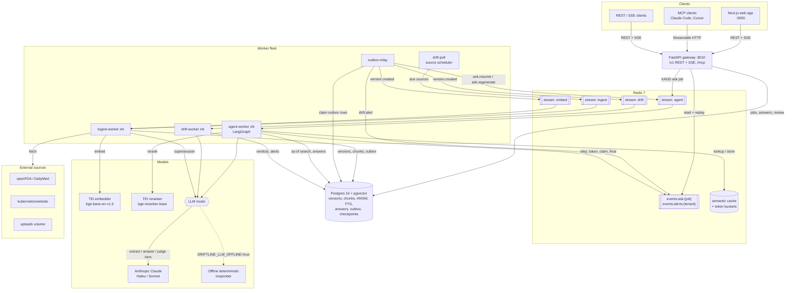
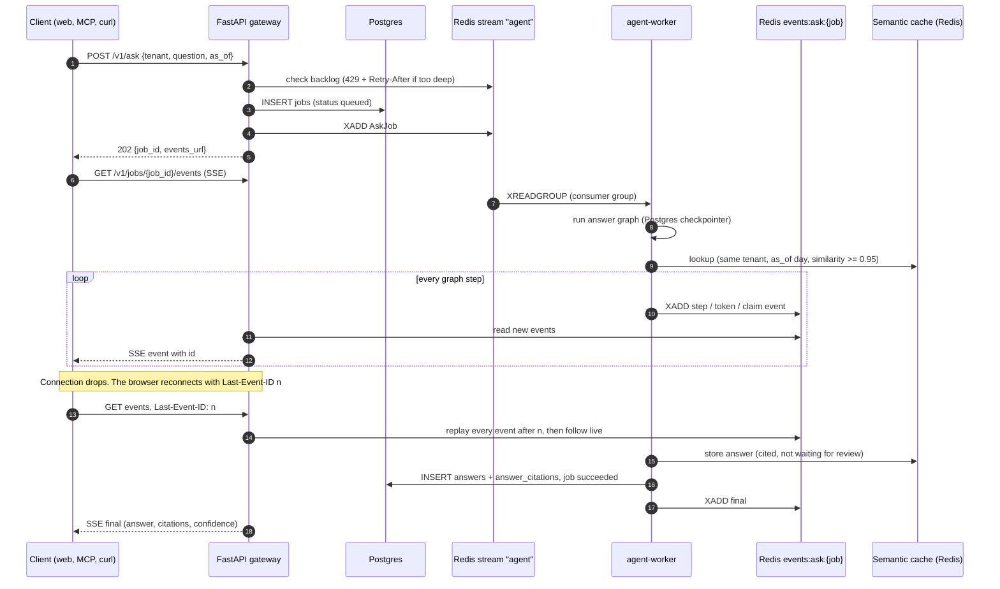
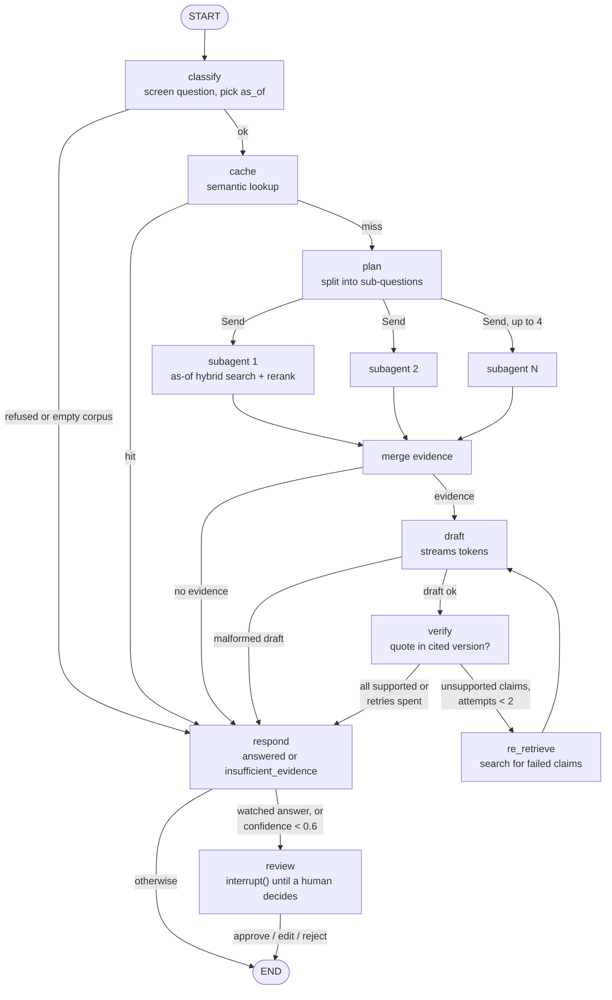
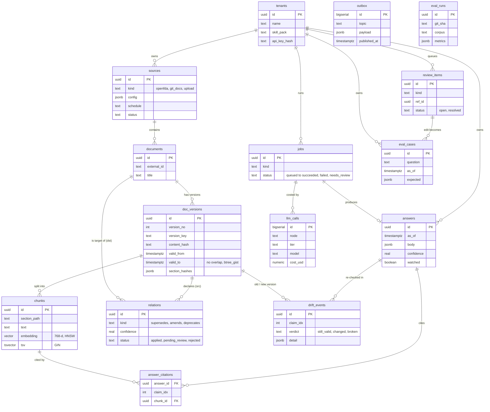
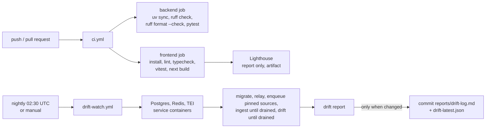

# Driftline architecture

Driftline is a modular monolith: one Python package, run as one HTTP gateway and a fleet of horizontally scalable workers. The processes never call each other directly. They share Postgres (the source of truth) and Redis (streams, caches and rate limits). Every service below is a real entry in [`deploy/compose/docker-compose.yml`](../deploy/compose/docker-compose.yml), except the web app, which runs on its own (`bun run dev`).

## 1. System overview

How to read it:

- **The gateway is thin.** It authenticates the tenant, writes a `jobs` row, pushes work onto a stream and serves events. It never calls a model.
- **Streams carry work, Postgres carries truth.** Anything that must not be lost (a new version, a drift alert, a reviewer's decision) is first written to the `outbox` table in the same transaction as the change. The `outbox-relay` then publishes it to Redis. If the relay crashes, the row is simply published later.
- **Every worker type scales out.** Consumer groups split the work, `XAUTOCLAIM` takes over messages from a dead consumer after 60 s, and the 3rd failed delivery goes to `dlq:<stream>`. `drift-poll` needs only one replica: it claims each due source with a compare-and-set.
- **The LLM router** has four tiers. `extract` is Haiku (planning, supersession). `answer` is Sonnet, then Haiku (drafting). `judge` is Sonnet, then Haiku (claim checks). `embed` goes to TEI. Optional fallbacks come after these: extra Claude models, then Gemini when `DRIFTLINE_GEMINI_API_KEY` is set. With `DRIFTLINE_LLM_OFFLINE=true`, the agent and drift workers swap every LLM tier for the in-repo deterministic responder. Without an LLM key, the ingest worker still chunks and embeds, but skips supersession extraction.

## 2. The ask lifecycle

What happens between `POST /v1/ask` and the final answer, including a dropped connection:

Notes:

- A cache hit skips the planner, retrieval and models entirely (step 9). Only cited answers that are not waiting for review are stored, and a hit is served only if every version it cites is still in force at the requested `as_of`.
- The event log is capped (10,000 events) and expires after 24 h. A client that asks for an expired range gets an `error` event with code `events_expired` instead of silent gaps. Heartbeats keep idle connections alive every 15 s.
- `GET /v1/jobs/{job_id}` returns the same final answer for clients that poll instead of streaming. The MCP `ask` tool uses the same job path and waits for the result.
- If a worker crashes mid-ask, another worker reclaims the stream entry and resumes from the last checkpointed node. A queued ask whose stream entry was lost is failed by the `reap` sweep (`enqueue_lost`), never left hanging.

## 3. The LangGraph answer graph

The real nodes and conditional edges of [`agents/graph.py`](../backend/src/driftline/agents/graph.py):

- **Insufficient evidence path.** If no claim survives verification (or there was no evidence or no valid draft), `respond` returns `status: insufficient_evidence` with the nearest in-force sources and `confidence: 0`. It never returns an unverified answer.
- **Confidence** is the share of claims that verified, scaled by 0.9 when a fallback model answered (`degraded`).
- **Review.** When the graph pauses at `review`, the worker opens a `low_confidence_answer` review item and marks the job `needs_review`. The reviewer's decision is written to the outbox as `ask.resume`, the relay puts it on the `agent` stream, and a worker resumes the same thread from its checkpoint.

## 4. Ingestion, outbox and drift detection

```mermaid
flowchart LR
  subgraph ingest["ingest-worker: stream ingest"]
    ENQ["drift-poll or CLI enqueue"] -->|"XADD ingest"| FETCH["connector fetch<br/>openFDA/DailyMed, k8s git, upload"]
    FETCH --> HASH["hash content<br/>+ per-section hashes"]
    HASH --> CHUNK["section-aware chunks<br/>256 tokens"]
  end

  subgraph tx["one Postgres transaction"]
    CLOSE["close previous version<br/>set valid_to"] --> INS["insert doc_version + chunks"]
    INS --> OBX["outbox row<br/>version.created"]
  end

  CHUNK --> CLOSE
  CHUNK -.->|"same as current version"| NOOP["no-op"]
  OBX --> RELAY["outbox-relay<br/>SKIP LOCKED"]
  RELAY -->|"XADD embed"| EMBED["ingest-worker: embed via TEI<br/>+ supersession extraction"]
  RELAY -->|"XADD drift"| ENGINE["drift-worker: drift engine"]
  EMBED -.->|"confidence < 0.8 or<br/>quote not found"| RQ

  ENGINE --> DIFF{"cited section:<br/>cited vs latest version"}
  DIFF -->|"unchanged, or changed<br/>but quote still verifies"| SV["still_valid<br/>re-point citation"]
  DIFF -->|"changed, quote fails"| CH["changed<br/>+ before/after diff"]
  DIFF -->|"section removed"| BR["broken"]

  CH --> ALERT["outbox row<br/>drift.alert"]
  BR --> ALERT
  BR --> RQ["review queue<br/>review_items"]
  ALERT -->|"relay"| ALOG[["events:alerts:{tenant}"]]
  ALOG --> SSE["GET /v1/alerts/stream<br/>SSE drift inbox"]
  RQ --> RES["POST /v1/review/{id}/resolve"]
  RES -->|"outbox ask.regenerate<br/>or ask.resume"| AGENT[["stream: agent"]]
  RES -->|"outbox cache.invalidate"| CINV["drop cached answers<br/>citing replaced versions"]
```

- **Exactly one version per change.** `upsert_version` compares the new content with the current version. If they match, nothing happens. Otherwise it closes the old window, inserts the new version and its chunks, and writes the `version.created` outbox row, all in one transaction. Reverting to older content creates a new version, too.
- **Fan-out.** `TOPIC_STREAMS` in [`ingest/outbox.py`](../backend/src/driftline/ingest/outbox.py) maps `version.created` to the `embed` and `drift` streams, and `ask.resume` / `ask.regenerate` to `agent`. `drift.alert` goes to the tenant's alert log, and the relay applies `cache.invalidate` directly.
- **The drift engine** compares each cited section between the cited version and the document's **latest** version, so a worker that falls behind (v1, v2, v3) evaluates once, against v3. All writes for one event happen in one transaction under a per-document advisory lock. A unique index on `(answer_id, new_version_id, claim_idx)` makes redelivery harmless. `still_valid` re-points silently; `changed` and `broken` raise alerts. `broken` also opens a `broken_answer` review item. Approving it regenerates the answer through the agent.
- **Review effects commit with the decision.** Resolving an item locks it (`FOR UPDATE`), so a second resolve gets 409. Its follow-ups (resume, regenerate, cache invalidation) are outbox rows in the same transaction.

## 5. Data model

The core tables, from the Alembic migrations in [`backend/migrations/versions`](../backend/migrations/versions):

`outbox` and `eval_runs` stand alone: the outbox is a queue of topics with JSON payloads, and an eval run records metrics per commit and corpus. Two smaller tables are not drawn: `source_cursors` (per-source fetch cursors) and the LangGraph checkpointer's own tables.

## 6. CI/CD and automation

The backend CI job runs the full suite against real service containers (testcontainers). The drift watch runs offline (`DRIFTLINE_LLM_OFFLINE=true`), so it needs no paid key. `eval.yml` gates pull requests on the offline eval, and `pages.yml` rebuilds and deploys the report site when reports change.
